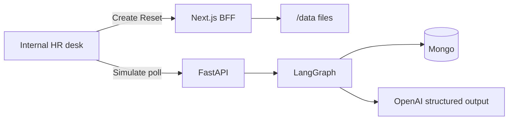

# Internal HR desk

The **Internal HR desk** is software for an HR staffing coordinator. It answers who is cleared to work the next day by reading emails, drug tests, and certifications, then marking each worker **Compliant** or **Non-compliant**.

## Problem thesis

**Who.** Compliance / onboarding specialists, recruiters, and dispatchers at a staffing firm. The owner pays for missed starts and audits.

**Pain.** “Is this person cleared to work *today*?” has no single answer. I-9 Section 2, licenses, certs, drug screens, Hep B / TB, and background checks live in spreadsheets, vendor emails, and memory. Teams find out at the client gate, on an empty shift, or when an auditor opens the file.

**Why it stays latent.** The workaround looks like work: a sheet of checkboxes, calendar chases, reminder emails. It **fails silently**. A filter hides an expired cert. “Processed” in a lab email is treated as a pass. Section 2 waits until Wednesday. There is no event until revenue or a fine lands, so the problem does not show up as a ticket — it shows up as a start that never billed.

**Cost (KPIs that justify the slice).**

| KPI | Industry signal | What the Internal HR desk is for |
| --- | --- | --- |
| I-9 paperwork fine | ICE civil penalties for substantive / uncorrected I-9 failures: **$288–$2,861 per form** (2025 inflation-adjusted matrix). [1][2] | Surface `missing` / `denied` I-9 **before** dispatch, not in an audit. |
| Inspection target | Temporary staffing is a named I-9 inspection focus; clients can share joint-employer risk. [3][4] | One list per worker, not six tools that do not talk. [5] |
| Time-to-clear | Coordinators still track licenses and I-9 Section 2 in Excel and chase managers by mail. [6][7] | Replace “open five inboxes” with one table of **words**. |
| Silent miss | Spreadsheets and ignored reminders; first real signal is a blocked start or audit. [6][7] | Never store a boolean. Missing file → `missing`, no LLM guess. |
| Label quality | The Internal HR desk is wrong if “processed” becomes Hep B `negative`. | Offline exact-match evals on those traps (see Evals). |

**Why an AI harness fits.** Inputs are messy prose (emails, cert markdown, a lab CSV). An LLM can extract a small, fixed label. **Where it does not fit:** legal determination of work authorization, E-Verify, or “do all of HR.” Clearance *rules* stay in code (Hep B / TB need `negative`; everything else needs `approved`).

## End user and interface

**User.** A non-engineer coordinator doesn't care about the latest AI model that is being used to parse the documents. They only want to know something: who can go to the workplace, what blocked them, what to do when it fails.

**Why a People table, not chat.** The Internal HR desk is a roster job (scan 10 rows before dispatch), not a conversation. Layout follows HR people directories (Deel / Gusto-style: name, role, actions top-right). Three buttons only:

| Button | Who it’s for | Result |
| --- | --- | --- |
| **+Create** | “New data was produced today (emails/certs/tests)” | 10 workers on disk. Cells stay `—`. |
| **Simulate** | “Tell me who clears.” | Status **words**, then Compliant / Non-compliant. Polls until done. |
| **Reset** | “Wipe the drill.” | Confirm modal, then empty Internal HR desk. |

Empty state until Create. Simulate and Reset stay visible but disabled. Errors (missing key, timeout) show on the page. Search is name or role. No checkmarks — a word is auditable.

**Stubbed on purpose.** The button **+Create** does not connect to a real inbox. It generates synthetic certs, lab emails, and drug-test rows to **mimic a normal day**: a vendor email landing in HR (I-9, Hep B, background), or a certificate dropped from a warehouse. That is enough to exercise parse + clearance without building Gmail or ATS plumbing.

In production, Create would be replaced by a connector: pull from the company mailbox, a document warehouse, or a vendor API, write the same file shapes under `/data` (or an equivalent store), then run Simulate unchanged. The harness is the parser and the Internal HR desk — not the ingest.

## Backend Architecture

Create writes disk in **Next.js**. Simulate parses in **FastAPI** (port **4000**). The browser never opens documents.

- **Creation** — `POST /api/create`: invent names and files; **code overwrites six passers** so the drill always has a clear set. No Mongo.
- **Simulation Process 1** — ingest roster → Mongo `pre_processed` (`status: null`) → return so the Internal HR desk can poll.
- **Simulation Process 2** — background parse, semaphore of **10**, persist after each worker, `complete: true`.
- **Failure:** missing file/row skips the LLM and stores `missing`. One parse exception does not kill the batch.

Layers, endpoints, and sequence diagrams: [system-design.md](system-design.md).

## AI Architecture

This is Anthropic’s **workflow**, not an **agent**: LLMs run on **predefined code paths**; the model does not pick tools. [8]

| Pattern | Where |
| --- | --- |
| **Prompt chaining** | ingest → persist → parse → persist-again |
| **Parallelization (sectioning)** | up to 10 workers in `parse_all` |
| **Structured outputs** | `ParseVerdict`: `is_there_one` + `result` ∈ `positive \| negative \| approved \| denied \| missing` |
| **Not used** | ReAct / tool loop, RAG, LlamaIndex, rerank, Ragas, prompt caching, per-type `tools=` |

Python already finds the `.md` / `.txt` / CSV row. The model only labels. One prompt (`parse-requirement` in Langfuse, local fallback if keys fail). `temperature: 0`.

**Why this is the right-sized harness.** An agent would re-decide which file to read. A retriever would search a corpus we already have as paths. The failure mode is a **wrong word**, so quality is exact match, not “faithfulness to chunks.”

## Evals

Offline, not on the Simulate request path: `cd backend && python -m evals.run_eval`.

- Gold file `backend/evals/parse_gold.json`: same schema as production.
- Score: **exact match** on `is_there_one` and `result`.
- Cases: valid vs expired cert, drug pos/neg, Hep B `positive` vs “processed” only, I-9 pass, wrong worker.

Last run: **7/8**. The miss is `hep-b-processed-only` (gold `denied`, model `missing`) — both fail clearance; the prompt currently allows both words. That is the known quality gap.

## Tooling and tradeoffs

| Chose | Against | Why |
| --- | --- | --- |
| Next BFF + FastAPI | Parse in the browser / one monolith | Create is file I/O; parse is a long job with Mongo. |
| LangGraph workflow | Free-running agent | Order and poll semantics are code, not a planner. |
| Structured outputs | Free text or checkmarks | The Internal HR desk and evals need a closed label set. |
| Langfuse prompt + fallback | Prompt only in git / only in cloud | Change without deploy; still runs if Cloud is down. |
| Exact-match gold | Ragas / LLM-as-judge | No retriever; the bug is the label. |
| Synthetic Create | Live Gmail / ATS | Challenge allows stubs; ingest is not the thesis. |

## Reflections

- **Time spent:** _fill in hours before submit._
- **Next:** real inbox/warehouse drop; “who owns the next chase”; I-9 day-1 / day-3 deadlines; tighten the denied vs missing prompt so evals hit 8/8.
- **Least sure:** whether coordinators will trust **words** over checkmarks on a real Monday; whether `denied` vs `missing` should be collapsed for the table even if gold stays strict.
- **Out of scope (honest):** E-Verify, auth, multi-tenant, production uptime.

## Sources

1. U.S. ICE, [Form I-9 Inspection Under INA § 274A](https://www.ice.gov/factsheets/i9-inspection) — fines for substantive and uncorrected technical/procedural failures; amounts adjusted annually.
2. Cozen O’Connor (2025), [Updated ICE Fine Matrix for Form I-9 Violations](https://www.cozen.com/news-resources/publications/2025/updated-ice-fine-matrix-for-form-i-9-violations) — **$288–$2,861** per paperwork violation (Federal Register, 2 Jan 2025).
3. Foley & Lardner (2025), [I-9 inspections targeting employers, including temporary staffing](https://www.foley.com/insights/publications/2025/01/immigration-law-enforcement-i-9-inspections-site-visits/).
4. *Daily Journal*, [ICE enforcement when using staffing agencies](https://www.dailyjournal.com/articles/384081-ice-enforcement-actions-how-to-protect-your-business-when-using-staffing-agencies) — joint-employer exposure.
5. r/RecruitmentAgencies, [We stopped paying for 6 tools that don’t talk to each other](https://www.reddit.com/r/RecruitmentAgencies/comments/1t3tlvf/we_stopped_paying_for_6_tools_that_dont_talk_to/).
6. r/humanresources, [Missing I-9 Section 2 deadline constantly](https://www.reddit.com/r/humanresources/comments/1fw9u7y/missing_i9_section_2_deadline_constantly_na/); [How do you track license and certification expiration dates?](https://www.reddit.com/r/humanresources/comments/1rnwfcm/how_do_you_track_employee_license_and/).
7. r/TravelNursing, [Tips from a compliance / onboarding specialist](https://www.reddit.com/r/TravelNursing/comments/s5iaan/tips_from_a_compliance_onboarding_specialist/); r/healthcareIT, [We’re drowning in renewals and compliance tracking](https://www.reddit.com/r/healthcareIT/comments/1s3ojvt/were_drowning_in_renewals_and_compliance_tracking/).
8. Anthropic, [Building effective agents](https://www.anthropic.com/engineering/building-effective-agents) — **workflow** (predefined paths) vs **agent** (model-chosen tools).
