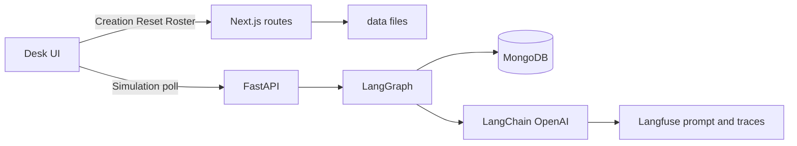
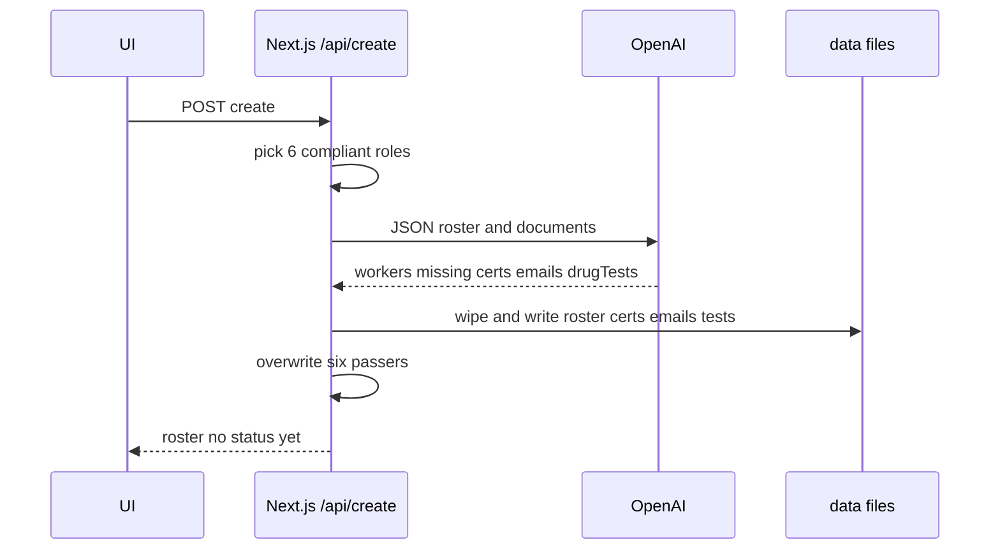
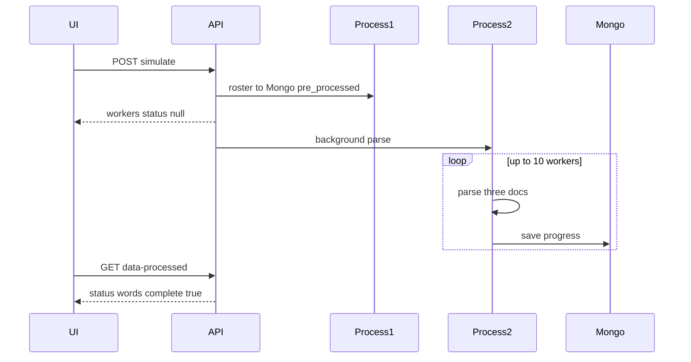
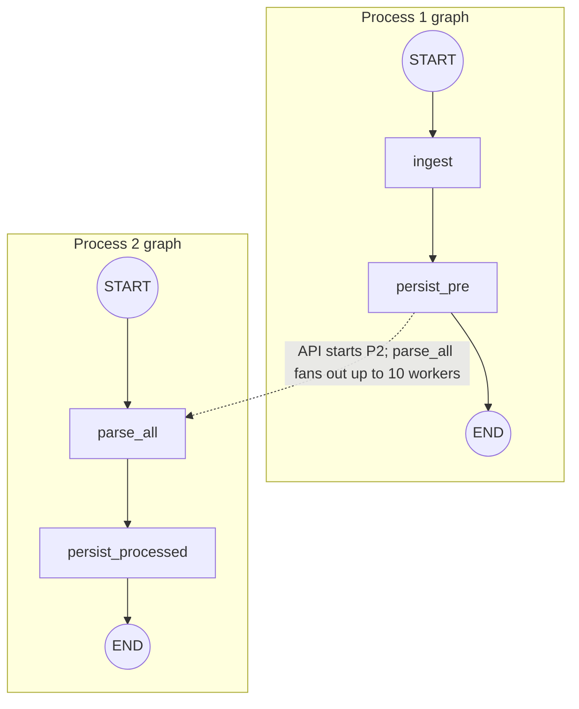

# Internal HR desk System Design


The Problem? Who is cleared to work. 

The Solution: The software reads emails/drug tests/certifications and determines what worker is compliant and ready to work the very next day.

## 1. Requirements

### 1.1 Non-functional Requirements

These are constraints of the running desk, not a production SLA.

| ID | Requirement |
| --- | --- |
| NFR-1 | **Split runtimes.** Next.js serves the desk on port **3000**. FastAPI serves Simulate on port **4000**. The BFF proxies `/backend/*` to `BACKEND_ORIGIN` (default `http://127.0.0.1:4000`). |
| NFR-2 | **Process split.** Creation and Reset of files run in Next.js. Parse and Mongo run in FastAPI. The browser never parses documents. |
| NFR-3 | **Non-blocking Simulate.** `POST /api/v1/simulate` returns after Process 1. Process 2 runs in `asyncio.create_task`. The desk polls; it does not wait on the HTTP request for every parse. |
| NFR-4 | **Parse concurrency.** Process 2 fans out with a semaphore of **10** workers. Each worker still parses its three requirements in order. |
| NFR-5 | **Poll budget.** The desk polls `GET /api/v1/data-processed` every **2s**, up to **90** attempts (~3 minutes), then surfaces a timeout. |
| NFR-6 | **Create budget.** `POST /api/create` may take up to **120s** (`maxDuration`). |
| NFR-7 | **Deterministic parse.** Simulate uses `temperature: 0` and OpenAI structured outputs (`ParseVerdict`). Status on Mongo is a **word**, never a boolean. |
| NFR-8 | **Secrets.** OpenAI and Langfuse keys live in `frontend/.env` and `backend/.env`. They are not committed. CORS on FastAPI allows only `localhost:3000` / `127.0.0.1:3000`. |
| NFR-9 | **Optional observability.** Langfuse traces and the `parse-requirement` prompt are best-effort. Missing keys or prompt → local fallback. Evals are offline (`python -m evals.run_eval`) and are not on the desk request path. |
| NFR-10 | **Local data.** Roster and documents live under `/data`. Mongo holds one `_id: latest` document per collection (`pre_processed`, `processed` in database `clearance` unless env overrides). |
| NFR-11 | **Degrade, don’t crash the batch.** A missing file or CSV row skips the LLM and stores `missing`. A parse exception for one requirement stores `missing` and continues the rest of that worker. |
| NFR-12 | **UI contract.** People directory (Deel-like). Requirement cells show status **words**, not checkmarks. Simulate and Reset stay visible but disabled when the roster is empty. |

### 1.2 Functional Requirements

| ID | Requirement |
| --- | --- |
| FR-1 | **People desk.** On `/`, show who is cleared to work: worker, role, three requirement cells, and an overall **Compliant** / **Non-compliant** status after Simulate. |
| FR-2 | **Empty state.** If there is no `roster.json`, show “No people yet”. No Req columns. **+Create** enabled; **Simulate** and **Reset** disabled. |
| FR-3 | **Load.** On refresh, load the roster from disk and any existing Mongo `processed` (else `pre_processed`) so partial or finished Simulate results survive a reload. |
| FR-4 | **Creation.** **+Create** generates **10** workers, one per catalog role in `frontend/lib/roles.ts`. Six roles are fully compliant; the rest fail at least one requirement (omit a file or write a failing result). |
| FR-5 | **Synthetic files.** Creation wipes `/data` and writes `roster.json`, `certs/<category>/<slug>.md`, `emails/<slug>-<suffix>.txt`, and `tests/test.csv`. Six passers are overwritten in code (valid certs, negative Hep B / TB, negative drug rows). |
| FR-6 | **No status at Create.** Creation returns a roster only. It does not call FastAPI, LangGraph, or Mongo. Requirement cells stay blank (`—`) until Simulate. |
| FR-7 | **Simulate ingest (Process 1).** **Simulate** reads `/data`, writes Mongo `pre_processed`, and a first `processed` copy with `status: null`, then returns that snapshot to the desk. |
| FR-8 | **Simulate parse (Process 2).** In the background, parse each worker’s three documents with the LLM, persist after each worker, and set `complete: true` when finished. The desk shows partial `status` words while polling. |
| FR-9 | **Document types.** Certificates (`.md`), emails (`.txt`), and drug-test CSV rows are parsed. A missing file or missing CSV row is `is_there_one: false`, `result: missing`, with no LLM call. A document for the wrong worker is `missing`. |
| FR-10 | **Parse schema.** Each LLM call returns `ParseVerdict`: `is_there_one` (bool) and `result` one of `positive`, `negative`, `approved`, `denied`, `missing`. One prompt (`parse-requirement`) serves all three types. |
| FR-11 | **Clearance rules.** Hep B / TB (infection screens) clear only on `negative`; `positive` fails. Certificates, I-9, background, and drug tests clear only on `approved`. A worker is **Compliant** only if all three requirements clear. |
| FR-12 | **Search.** Filter the table by worker name or role. |
| FR-13 | **Reset.** **Reset** always asks in a “Permanently delete” modal. Confirm deletes generated files under `/data` (keeps `.gitkeep`) and drops Mongo simulate collections. The desk returns to the empty state. |
| FR-14 | **Busy states.** Disable Create / Simulate / Reset while creating, simulating, or resetting. Show Creating… / Simulating… and desk errors (missing API key, empty OpenAI response, parse failure, poll timeout). |
| FR-15 | **Evals.** Gold cases in `backend/evals/parse_gold.json` score exact match on `is_there_one` and `result`, covering pass/fail certs, drug pos/neg, Hep B `positive` vs “processed” only, I-9 pass, and wrong worker. |

## 2. High-level architecture
Two processes are used to portray this whole scenario.

- **Creation** (via the **+Create** button) writes files. It creates synthetic data to mimic how data changes on a daily basis. For example, a new email reaches the company inbox about the drug-test of a specific worker, or a new certificate has been collected from a datawarehouse.
- **Simulation** (via the **Simulate** button) reads and parses those files. It uses an LLM to determine the status of each document, then decides if the worker is compliant or not.

Creation always comes first. Simulation has two sub-processes (ingest, then parse).



## 3. Layers

**Backend** is a layered pipeline, not a DDD rewrite.

| Layer | Job | Where |
| --- | --- | --- |
| API | HTTP only: simulate, poll, reset | `backend/app/main.py` |
| Orchestration | Two compiled LangGraph graphs | `backend/app/graph.py` |
| Domain | Status words and who clears | `backend/app/services/clearance.py` |
| Strategy | Langfuse prompt or local fallback | `backend/app/services/prompts.py` |
| Facade | Langfuse host and keys | `backend/app/services/langfuse.py` |
| Repository | Mongo save / load / drop | `backend/app/repositories/workers.py` |

**Frontend** is App Router BFF plus one Redux feature slice.

| Pattern | Job | Where |
| --- | --- | --- |
| BFF | Create, Reset, roster on disk; proxy Simulate to FastAPI | `frontend/app/api/*`, `frontend/app/backend/[...path]/route.ts` |
| Facade | Fetch URLs | `frontend/lib/api/desk.ts` |
| Feature slice | Load, create, simulate poll, reset | `frontend/lib/store/deskSlice.ts` |
| Presenter | Table and buttons | `frontend/app/desk.tsx` |
| Domain helper | Infection screens vs other reqs | `frontend/lib/clearance.ts` |

Create does **not** run on the backend. Simulate does **not** parse in the browser.

## 4. Creation process
_This happens right after the user clicks on the **`+Create`** button. It must finish before Simulate, because Simulate only reads whatever is on disk._

Creation is a frontend BFF job (`frontend/app/api/create/route.ts`). It does not touch FastAPI, LangGraph, or Mongo. The desk POSTs `/api/create`; Next.js invents a day’s worth of files, then returns the roster file `roster.json`. Status words do not exist yet.

- Pick six role ids that must fully comply (the rest must fail at least one requirement).
- Call OpenAI with `response_format: json_object` for names, cert markdown, emails, and drug-test rows.
- Wipe `/data` and write `roster.json`, `certs/…/*.md`, `emails/*.txt`, and `tests/test.csv`.
- Overwrite the six compliant workers in code so their files always pass (valid certs, negative infection screens, negative drug rows). Remaining workers may omit files or get a failing result.

That is the synthetic analogue of a new inbox email or a certificate arriving from a warehouse. The desk then shows the new roster. Parse starts only when the user clicks **Simulate**.



## 5. Two sub-processes within the Simulation process
_This happens right after the users clicks on the **`Simulate`** button_

- Process 1 reads `/data`, writes Mongo `pre_processed` (and a first `processed` copy with `status: null`), then returns.
- Process 2 runs in the background (`asyncio.create_task`). The desk polls `GET /api/v1/data-processed` until `complete` is true.



## 6. Parallel workers

Process 2 fans out with `asyncio.gather` and a semaphore of **10**. Each worker still parses its three requirements in order. A lock writes Mongo after each worker so the desk can show partial `status` words.

## 7. Create vs Simulate LLMs

- **Create** lives in `frontend/app/api/create/route.ts`. OpenAI returns JSON. Code then overwrites six workers so their files always pass (valid certs, negative infection screens, negative drug rows). Remaining workers may omit files.
- **Simulate parse** uses LangChain `ChatOpenAI.with_structured_output(ParseVerdict)` (`is_there_one` + `result`). Labels stored on `status` are `approved`, `denied`, `positive`, `negative`, or `missing` — never booleans.

Infection screens (Hep B / TB): `negative` clears, `positive` fails. Everything else needs `approved`.

## 8. Mongo

Collections come from env (`MONGODB_PRE_COLLECTION`, `MONGODB_PROCESSED_COLLECTION`). Defaults: `pre_processed` and `processed` in database `clearance`. One document `_id: latest` per collection.

## 9. Langfuse

Prompt name: `parse-requirement`. If keys or host fail, parse uses the local fallback in `backend/app/services/prompts.py`. Callbacks trace each parse. Evals stay in `backend/evals` and are not part of the desk request path.

## 10. AI architecture

The LLM step is one extraction call. The graph exists so that step sits in a **fixed workflow**, not a free-running agent.

**Why a graph.** Ingest, persist, parse, and persist-again are different jobs with different failure modes. 
- Process 1 must finish and return so the desk can poll.
- Process 2 must parse in the background and write partial `status` words. 

LangGraph holds that order in compiled nodes and shared state (`workers`, `processed`).

**Anthropic pattern.** In [Building effective agents](https://www.anthropic.com/engineering/building-effective-agents), Anthropic groups these designs as **agentic systems**, then splits them:

- **Workflow** — LLMs and tools run on **predefined code paths**.
- **Agent** — the model **directs its own process and tool use** (a model using tools in a loop).

This desk is a **workflow**, not an agent. There is no planner, no ReAct loop, and no model-chosen tools. The two named workflow patterns in use:

- **Prompt chaining** — Process 1 then Process 2 is a fixed sequence:
  ```bash
  ingest → persist → parse → persist-again
  ```
  with Python between the LLM calls.

- **Parallelization (sectioning)** — `parse_all` fans out up to 10 workers; each worker is an independent subtask, then results are written back in code.

It is not **routing**, **orchestrator-workers**, or **evaluator-optimizer**. Subtasks are known in advance (three docs per worker), so an orchestrator LLM does not decide what to parse.



`parse_all` fans out workers; each worker still reads its three docs **in order**. Per-type handling is **Python**, not LLM function calling:

| Type | How the document reaches the model |
| --- | --- |
| `certificate` | Read the `.md` file as one string. |
| `email` | Read the `.txt` file as one string. |
| `test` | Find that worker’s row in `tests/test.csv`, then format the row as text. Missing row → `missing`, no LLM call. |
| Missing file | `is_there_one: false`, `result: missing`. No LLM call. |

One prompt (`parse-requirement`) and one schema serve all three types. `requirement_type` and `requirement_name` are template variables so the model can apply infection vs credential rules. There are **no** OpenAI/Anthropic tool definitions, **no** per-type `tools=` functions, and **no** Instructor / PydanticAI agent.

**Structured outputs (included).** Simulate uses OpenAI structured outputs through LangChain: `ChatOpenAI.with_structured_output(ParseVerdict)`. `ParseVerdict` is a Pydantic model (`is_there_one: bool`, `result` one of `positive | negative | approved | denied | missing`). Create uses a lighter form: `response_format: json_object`, then TypeScript writes the six guaranteed passers. Anthropic structured outputs are not in this stack.

**Langfuse (included).** Tracing: `CallbackHandler` on each `ainvoke`. Prompt management: `get_prompt("parse-requirement")` with a local fallback. That is observability + a central prompt, not a production agent dashboard.

**Evals (why this set).** The desk fails if the model returns the wrong **label** (e.g. treating “processed” as Hep B negative, or a boolean instead of a word). So evals are a gold JSON file scored with **exact match** on `is_there_one` and `result`, using the same `build_prompt` + `make_llm` as production. Cases cover the three document types and the traps that matter here: valid vs expired cert, drug negative vs positive, Hep B `positive` vs “processed” only, I-9 pass, and a document for the wrong worker. They run offline (`python -m evals.run_eval`). This is not RAG evaluation: there is no retriever, no LlamaIndex, no reranking, and no Ragas metrics (faithfulness / context recall). Prompt caching is unused; each parse is a short single-shot call.

FastAPI listens on **port 4000**. Next.js proxies `/backend/*` to `BACKEND_ORIGIN` (default `http://127.0.0.1:4000`).
